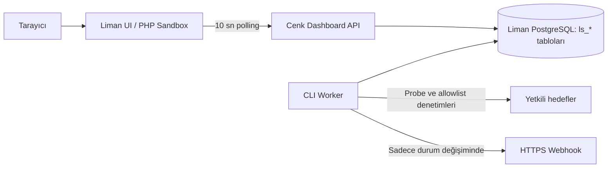

# Cenk Scoreboard for Liman MYS

Cenk; Liman MYS üzerinde çalışan, servis sürekliliği, White Team puanları ve zafiyet uyumluluğunu tek ekranda toplayan bir siber tatbikat skor tahtasıdır. HTTP, HTTPS, SSH, DNS, LDAP, WINRM ve PING kontrollerini destekler.

**Uyumluluk:** Paket, Liman sürüm kodu **1093** ve sonrası için tanımlıdır.


## Çalışma mantığı



1. Liman, `views/functions.php` üzerinden Cenk fonksiyonlarını çalıştırır. Dashboard isteği güvenilir `server()->id` bağlamını kullanır; tarayıcıdan gelen sunucu veya kullanıcı kimliği kabul edilmez.
2. Dashboard, PostgreSQL içindeki `ls_*` tablolarından tutarlı bir snapshot okur. Blade arayüzü servis/güvenlik matrisini, puan tablosunu, trendi ve son denetim kayıtlarını gösterir.
3. Ayrı CLI worker, izinli CIDR kapsamındaki servisleri ölçer. Her sonuç append-only `ls_service_logs` tablosuna yazılır.
4. Worker, yalnızca yönetici yapılandırmasındaki allowlist anahtarıyla eşleşen zafiyet komutlarını doğrudan argv olarak çalıştırır; shell kullanmaz. `SSH_AUDIT`, worker makinesindeki bir denetim wrapper’ını ifade eder; hedefe SSH ile bağlanması gerekiyorsa bu wrapper bağlantıyı kendisi yönetir. Exit code `0`, `Patched`; diğer sonuçlar `Vulnerable` kabul edilir.
5. Zafiyet denetim zamanı, exit code, süre ve maskelenmiş çıktı `ls_vulnerability_logs` tablosuna eklenir. Durum değişirse isteğe bağlı HTTPS webhook gönderilir.

## Skor modeli

```text
Toplam puan = SLA puanı + görev/ceza puanı + kapatılan zafiyet puanı
```

- **SLA:** Servis ağırlığı, ölçülen uptime oranıyla çarpılır. Ölçüm olmayan veya worker gecikmesi nedeniyle kapsanmayan süre uptime sayılmaz.
- **Görev/ceza:** White Team, idempotent `request_id` ile pozitif görev veya negatif ceza kaydı ekler. Red Range savunma poligonu bu eksene otomatik beslenebilir (bkz. Red Range `BRIDGE.md`): poligonun olay akışı `event_id`→`request_id` eşlemesiyle `ls_injects` defterine çevrilir.
- **Güvenlik:** Durumu `Patched` olan zafiyetlerin puanı eklenir. Trend grafiği bu değişimi yalnızca denetimin gerçekleştiği andan sonraki zaman noktalarına yansıtır.

Servis sonucu, bir sonraki sonuca veya en fazla kendi kontrol aralığının sonuna kadar geçerlidir. Grafik son 60 dakika için 61 kümülatif zaman noktası üretir; gelecekteki ölçümler veya puan kayıtları geçmişi değiştirmez.

## Roller ve erişim

| Liman rolü | İzinler |
|---|---|
| İzleyici / Blue Team | `index`, `ls_dashboard` |
| White Team | İzleyici izinleri + `ls_create_team`, `ls_create_service`, `ls_add_inject` |

Liman `can()` denetimi her endpointte uygulanır. Takım, servis ve inject kayıtları sadece ilgili Liman sunucusunun kapsamı içinde oluşturulabilir.

## Yerel Docker ile hızlı başlangıç

Gereksinimler: Docker Desktop veya Docker Engine, Docker Compose v2 ve Git Bash ya da WSL.

```bash
./local_run.sh
```

Betik Liman, PostgreSQL, Redis, WebSSH ve HTTP/SSH açık `mock-target` konteynerlerini başlatır; rastgele yerel sırları izlenmeyen `.env.local` dosyasında üretir; migration ve sınırlı `ls_scoreboard` rolünü kurar; örnek Blue Team/servis/zafiyet verisini ekler; worker’ı `nohup`, PID ve `flock` ile başlatır.

Terminalde verilen bilgilerle `http://localhost:8000` adresine giriş yapın ve **Local Blue Team → Cenk Skor Tahtası** eklentisini açın. Mock hedefini durdurup başlatarak servis/zafiyet durumunu deneyebilirsiniz:

```bash
docker compose --env-file .env.local -f docker-compose.local.yml stop mock-target
docker compose --env-file .env.local -f docker-compose.local.yml start mock-target
```

## Üretim kurulumu

1. `powershell -ExecutionPolicy Bypass -File scripts/build.ps1` ile paketi oluşturun.
2. `dist/Cenk-1.0.0.zip` paketini Liman’a yükleyin.
3. `database/migrations/001_locked_shields.sql` ve `database/grants.sql` dosyalarını Liman’ın mevcut PostgreSQL veritabanında veritabanı sahibi ile çalıştırın.
4. `config/locked-shields.example.php` dosyasını eklenti dizini dışında `/etc/liman/locked-shields.php` olarak yerleştirin. DSN, `scopes`, credential referansları, allowlist denetimleri ve webhook hedeflerini yapılandırın.
5. `deploy/locked-shields-worker.service` unit dosyasını eklentinin Linux hesabına göre düzenleyip etkinleştirin.

Tekrar çalıştırılabilir kurulum için [DEPLOYMENT.md](DEPLOYMENT.md), makine hazırlığı için [MAKINE_HAZIRLAYAN_EKIP_TEKNIK_REHBERI.md](MAKINE_HAZIRLAYAN_EKIP_TEKNIK_REHBERI.md) dosyalarına bakın.

## Zafiyet denetimleri ve uyarılar

`ls_vulnerabilities.command` alanı komut metni değildir; yapılandırmadaki allowlist anahtarıdır:

```php
'vulnerability_checks' => [
    'LIMAN_SERVER_UUID' => [
        'dirtypipe-kernel-patch' => [
            'check_type' => 'SSH_AUDIT',
            'argv' => ['/usr/local/libexec/check-dirtypipe-patch'],
            'timeout_ms' => 3000,
        ],
    ],
],
'notifications' => [
    'LIMAN_SERVER_UUID' => ['webhooks' => ['https://alerts.example.invalid/cenk']],
],
```

Komutlar shell üzerinden çağrılmaz ve 100–5000 ms süre sınırına sahiptir. Kanıt çıktısı 1000 karakterle sınırlanır; `password`, `token`, `secret`, `authorization` ve API anahtarı kalıpları maskelenir. Webhook yalnızca `Vulnerable` ve `Patched` arasındaki geçişte çağrılır; URL içinde erişim bilgisi kullanmayın.

## Desteklenen probe’lar

| Protokol | Başarı koşulu |
|---|---|
| HTTP / HTTPS | Beklenen HTTP durumu, isteğe bağlı gövde içeriği ve HTTPS için sertifika/hostname doğrulaması |
| SSH | Geçerli SSH banner’ı |
| DNS | Hedef DNS sunucusundan doğrulanmış A/AAAA yanıtı |
| LDAP / LDAPS | RootDSE/base okuması; kimlik doğrulaması için TLS gerekir |
| WINRM | Geçerli WS-Man Identify yanıtı |
| PING | ICMP echo yanıtı |

Hedef IP, ilgili Liman sunucusunun `scopes` CIDR listesinde bulunmalıdır. Worker paralelliği varsayılan olarak 8, üst sınırı 32’dir. PostgreSQL lease ve `FOR UPDATE SKIP LOCKED` mekanizması aynı servisin eşzamanlı iki kez ölçülmesini engeller.

## Doğrulama

```powershell
$env:TEST_POSTGRES_PASSWORD = -join ((48..57) + (97..102) | Get-Random -Count 48 | % {[char]$_})
$env:TEST_RUNTIME_DB_PASSWORD = -join ((48..57) + (97..102) | Get-Random -Count 48 | % {[char]$_})
docker compose -f tests/compose.yaml up --build --abort-on-container-exit --exit-code-from php --attach php
docker compose -f tests/compose.yaml down
npm ci
npm run check
```

Test paketi gerçek PostgreSQL, PHP Sandbox/Blade, worker, ağ probe’ları, zafiyet geçmişi, puan trendi ve sınırlı veritabanı izinlerini doğrular. GitHub Actions aynı kontrolleri `main` dalına gelen her push ve pull request için çalıştırır.

## Dizin yapısı

```text
app/                    Skor, worker, probe, politika ve bildirim kodu
views/                  Liman fonksiyonları ve Blade dashboard
database/               Migration ve sınırlı çalışma zamanı izinleri
config/                 Örnek üretim yapılandırması
deploy/                 Systemd worker unit dosyası
local/                  Docker harness başlatma ve seed betikleri
tests/                  PostgreSQL, sandbox, worker ve UI testleri
scripts/build.ps1       Paket üretimi ve içerik denetimi
```

## Lisans

Bu proje [MIT License](LICENSE) ile lisanslanmıştır. Chart.js lisans bilgisi için [THIRD_PARTY.md](THIRD_PARTY.md) dosyasına bakın.

## Destek

Destek ve geri bildirim için: [cckberk@gmail.com](mailto:cckberk@gmail.com)
