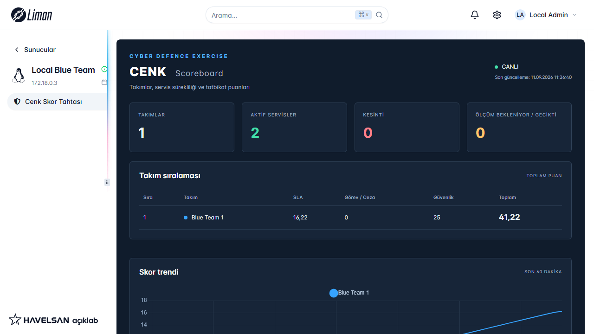

# Liman MYS — Cenk Scoreboard

**Otomatik DevOps kurulumu:** `liman` kullanıcılı systemd servisi, istenen storage yolu ve uçtan uca API smoke testi için [DEPLOYMENT.md](DEPLOYMENT.md) dosyasını kullanın. Aşağıdaki manuel kurulum alternatif kısıtlı rol profilidir.

PHP Sandbox + Liman Blade + Liman `request()` altyapısı üzerinde çalışan tatbikat skor tahtası. HTTP, HTTPS, SSH, DNS, LDAP, WINRM ve PING kontrolleri; ağırlıklı SLA; White Team görev/ceza günlüğü; servis matrisi ve Chart.js trend grafiği içerir. NATO'nun resmî ürünü veya resmî puanlama algoritması değildir.



## Quick start / Hızlı başlangıç

**TR:** Geliştirme için `./local_run.sh` komutu Liman, PostgreSQL, Redis ve HTTP/SSH hedefini Docker ile başlatır; ilk çalışmada izlenen dosya dışında kalan `.env.local` içine rastgele yerel sırlar üretir. `http://localhost:8000` üzerinden Liman'a giriş yaptıktan sonra Cenk Skor Tahtası açılır. Üretimde ZIP'i Liman'a yükleyin, migration'ı ana PostgreSQL veritabanında çalıştırın ve worker'ı servis olarak başlatın.

**EN:** For development, `./local_run.sh` starts Liman, PostgreSQL, Redis, and an HTTP/SSH target with Docker. On first run it creates random local credentials in the ignored `.env.local` file. Sign in at `http://localhost:8000` and open Cenk Scoreboard. For production, upload the ZIP to Liman, apply the migration to Liman's PostgreSQL database, and run the worker as a service.

**Architecture / Mimari:** Browser → Liman UI and PHP Sandbox → Cenk Blade/Chart.js dashboard → PostgreSQL (`ls_*` tables). The background worker probes scoped services and runs only configured vulnerability-check commands; results, exit codes, durations and redacted evidence are retained in the security audit history. The score trend includes SLA, White Team adjustments, and historical security compliance. Service and security matrices poll every 10 seconds.

## Mimari ve Liman uyumu

Kaynak incelemesinde doğrulanan entegrasyon noktaları:

| Liman altyapısı | Bu eklentideki kullanım |
|---|---|
| PHP Sandbox'ın `views/functions.php` giriş noktası | `index`, `ls_dashboard`, `ls_create_team`, `ls_create_service`, `ls_add_inject` |
| `view()` / BladeOne | `views/index.blade.php`; ayrı HTML uygulaması veya Laravel kurulumu yok |
| `API()` / `publicPath()` | Liman engine URL'leri ve eklentiye ait statik dosyalar |
| `request(url, FormData, success, error)` | Liman'ın CSRF ve server/extension bağlamını eklediği dahili JS yardımcısı |
| `respond(message, status)` | Liman'ın JSON yanıt zarfı; HTTP 200 içindeki hata statüleri de arayüzde kontrol edilir |
| `can()`, `user()`, `server()` | Liman fonksiyon izinleri, kayıt sahibi ve sunucu izolasyonu |
| Liman ana PostgreSQL veritabanı | Aynı veritabanında `ls_*` tablolarına özel, kısıtlı PDO bağlantısı |

Sandbox, Core Laravel uygulamasından ayrı bir PHP işlemidir; burada `DB::table()` veya Core `.env` dosyasını doğrudan okumak kullanılmaz. `/etc/liman/locked-shields.php` içindeki DSN **Liman'ın mevcut PostgreSQL veritabanına** bağlanır. Üretim için yeni veritabanı kurulmaz. Docker Compose yalnızca izole otomatik test içindir.

İncelenen kaynaklar:

- [Liman Core](https://github.com/limanmys/core/tree/54b6a0ff259d0fa01217f3f04d5391f7a1ab8956): manifest yükleme, rol/fonksiyon yönetimi, `resources/assets/js/liman.js`.
- [PHP Sandbox](https://github.com/limanmys/php-sandbox/blob/9389fe9a62e15a838c0efdda87f0c6bc768d261b/index.php): helper'lar ve eklenti dispatch mekanizması.
- [Fiber Render Engine](https://github.com/limanmys/fiber-render-engine/blob/06eb0dc3769c5178009edd546bf1fd035aa3649e/internal/sandbox/command_generator.go): fonksiyon izinleri ve şifrelenmiş sandbox bağlamı.
- [Liman Ansible eklentisi](https://github.com/limanmys/liman-ansible): Blade, manifest ve statik dosya kullanımı.

Manifest adı `Cenk` yalnızca harf içerir; incelenen Fiber sürümünün ad doğrulaması bunu gerektirir. Sürüm eşiklerinin kurulumlar arasında farklı olması nedeniyle manifestte doğrulanmamış bir `supportedLiman` kodu verilmemiştir. Hedef, bu PHP Sandbox sözleşmesini kullanan Liman kurulumlarıdır.

## Gereksinimler

- Liman PHP Sandbox; Linux PHP **8.1+** önerilir, PostgreSQL **12+**.
- PHP uzantıları: `pdo_pgsql`, `curl`, `ldap`, `dom`, `mbstring`, `json`; CLI worker için `posix`, `pcntl` ve etkin `proc_open`.
- `iputils-ping`; HTTPS/LDAPS için güvenilen CA zinciri.
- Eklenti Linux hesabının yapılandırmayı okuyabilmesi ve tatbikat ağlarına çıkabilmesi.
- Chart.js **4.4.8** paket içinde bulunur; çalışırken CDN veya npm bağlantısı gerekmez.

## Kurulum

### 1. ZIP'i oluştur ve Liman'a yükle

Windows geliştirme ortamında:

```powershell
powershell -ExecutionPolicy Bypass -File scripts/build.ps1
```

`dist/Cenk-1.0.0.zip` dosyasını Liman eklenti yükleme ekranından yükleyin ve bir Liman sunucusuna bağlayın. Eklenti dizini `/liman/extensions/cenk` olur. ZIP kökünde `db.json` ve `views/functions.php` bulunur. Testler, test şifreleri ve geliştirme bağımlılıkları ZIP'e alınmaz.

### 2. Migration'ı Liman'ın mevcut veritabanında çalıştır

Aşağıdaki `LIMAN_DB_ADI` ifadesini Liman'ın `DB_DATABASE` değeriyle değiştirin; uzak PostgreSQL kullanıyorsanız ilgili host/port seçeneklerini ekleyin. Komutları veritabanı yöneticisi uygular:

```bash
sudo -u postgres psql -v ON_ERROR_STOP=1 -d LIMAN_DB_ADI \
  -f /liman/extensions/lockedshields/database/migrations/001_locked_shields.sql
sudo -u postgres psql -v ON_ERROR_STOP=1 -d LIMAN_DB_ADI
```

psql içinde:

```sql
CREATE ROLE ls_scoreboard LOGIN NOSUPERUSER NOCREATEDB NOCREATEROLE;
\password ls_scoreboard
\i /liman/extensions/lockedshields/database/grants.sql
\q
```

Migration tekrar çalıştırılabilir. Runtime rolü `ls_*` tablolarına SELECT/INSERT ve yalnızca servis zamanlayıcı sütunlarına UPDATE alır. Log/inject değiştirme ve silme yetkisi verilmez. Core tablolarına yetki verilmez; mevcut PostgreSQL kurulumunda `PUBLIC` rolüne verilmiş geniş yetkiler varsa bunlar ayrıca gözden geçirilmelidir. Migration veritabanı sahibi tarafından yapılır; eklenti sayfası açılırken otomatik çalıştırılmaz.

### 3. Bağlantı ve tatbikat ağlarını yapılandır

Liman'daki eklentinin UUID'sini ve bağlandığı sunucunun UUID'sini alın. Native Liman kurulumunda eklenti Linux hesabı eklenti UUID'sidir:

```bash
sudo install -d -m 0750 /etc/liman
sudo install -m 0640 -o root -g EKLENTI_UUID \
  /liman/extensions/lockedshields/config/locked-shields.example.php \
  /etc/liman/locked-shields.php
```

Dosyayı düzenleyin:

- DSN host/port/dbname değerleri Liman'ın ana PostgreSQL veritabanını göstermeli; kullanıcı `ls_scoreboard` olmalı.
- `scopes` anahtarları gerçek **Liman sunucu UUID'leri**, değerleri izin verilen tatbikat CIDR ağları olmalı.
- `/etc/liman` dizininde eklenti grubuna geçiş izni verin: örneğin `sudo chgrp EKLENTI_UUID /etc/liman`. Mevcut dizinin başka uygulama izinlerini koruyun; gerektiğinde ACL kullanın.
- Gerekirse `credentials` altında sunucuya özel LDAP/WinRM hesapları tanımlayın. Veritabanına ve tarayıcıya yalnızca referans adı gider.
- PostgreSQL `pg_hba.conf` içinde bu sınırlı hesabın bağlantısına izin verin.

Her API çağrısı scope'u güvenilir `server()->id` üzerinden alır. Tarayıcıdan gönderilen `server_id`, `created_by`, rol veya zaman damgası uygulama verisi olarak kabul edilmez. Aynı extension hesabındaki farklı sunucular için ayrı scoreboard verisi tutulur.

### 4. Worker'ı etkinleştir

`deploy/locked-shields-worker.service` içindeki `User`/`Group` alanlarını eklenti Linux hesabıyla değiştirin, sonra:

```bash
sudo install -m 0644 /liman/extensions/lockedshields/deploy/locked-shields-worker.service \
  /etc/systemd/system/locked-shields-worker.service
sudo systemctl daemon-reload
sudo systemctl enable --now locked-shields-worker.service
sudo systemctl status locked-shields-worker.service
```

İlk çalıştırmayı kontrol etmek için:

```bash
sudo -u EKLENTI_UUID php /liman/extensions/lockedshields/bin/worker.php --once
sudo journalctl -u locked-shields-worker.service -n 50
```

Liman container kurulumunda systemd yerine aynı PHP CLI worker'ını supervisor/ayrı süreç olarak çalıştırın; `/etc/liman/locked-shields.php`, eklenti dosyaları ve aynı PostgreSQL bağlantısı erişilebilir olmalıdır. `LS_CONFIG_PATH` yalnızca yönetici tarafından süreç ortamında alternatif yapılandırma yolu vermek içindir; HTTP girdisinden okunmaz.

### 5. Liman rollerini ata

| Rol | Fonksiyon izinleri |
|---|---|
| İzleyici / Blue Team | `index`, `ls_dashboard` |
| White Team | Yukarıdakiler + `ls_create_team`, `ls_create_service`, `ls_add_inject` |

Sunucu ve eklenti erişimini de Liman rol ekranından verin. Liman yöneticileri yerleşik `can()` davranışı gereği tüm fonksiyonlara erişir. Sadece HTML gizleme kullanılmaz; her PHP endpoint izni yeniden denetler.

Dashboard'daki White Team bölümünden takım, servis ve görev/ceza kaydı ekleyin. Matrisin ortak sütunları servis adına göre oluşur; farklı takımlardaki eşdeğer servislere aynı adı verin. Adlar ve ağırlıklar yarışma sırasında arayüzden değiştirilmez; geçmiş puanların sonradan farklı hesaplanması önlenir. Takımların karşılaştırılabilmesi için aynı servis ağırlıklarıyla hazırlanması gerekir.

## Probe davranışları

Tüm ağ kontrolleri **Liman worker'ının çalıştığı makineden** yapılır; bağlı sunucuda uzaktan kod çalıştırılmaz. IP adresleri scope CIDR listesinde bulunmalıdır. Alan adı çözümlemesinin dış hedefe kaçmasını önlemek için hedef IPv4/IPv6 istenir; HTTP sanal sunucu/TLS adı `hostname` ile belirtilir ve cURL hedef IP'ye sabitlenir.

| Protokol | Başarı koşulu | Örnek seçenekler |
|---|---|---|
| HTTP | Varsayılan 2xx/3xx; yönlendirme takip edilmez; isteğe bağlı kod/içerik kontrolü | `{"path":"/health","expected_status":200,"contains":"OK"}` |
| HTTPS | HTTP koşulları + geçerli TLS sertifika zinciri/hostname | `{"hostname":"web.example.test","path":"/health"}` |
| SSH | Gerçek `SSH-2.0` veya `SSH-1.99` bannerı; kullanıcı girişi sınanmaz | `{}` |
| DNS | Hedef DNS sunucusuna UDP sorgusu; transaction/soru eşleşmesi ve A/AAAA cevabı | `{"dns_name":"web.example.test","dns_type":"A"}` |
| LDAP | Anonim veya yapılandırılmış bind ve RootDSE/base okuması | `{"ldap_base":"dc=example,dc=test"}` |
| LDAP + TLS | LDAPS bind/read; kimlik bilgisiyle bind için TLS gerekir; portu 636 seçin | `{"tls":true,"credential":"ldap-reader"}` |
| WINRM | `/wsman` SOAP Identify isteğine gerçek namespace'li IdentifyResponse | `{"credential":"winrm-reader"}` |
| WINRM + TLS | HTTPS WS-Man; portu 5986 seçin | `{"tls":true,"hostname":"win.example.test","credential":"winrm-reader"}` |
| PING | Bir ICMP echo cevabı; port alanı kullanılmaz | `{}` |

WinRM `401` cevabı tek başına başarı sayılmaz. Kimlik isteyen Windows hedeflerinde scope'a bağlı `credentials` kaydı gereklidir. HTTP/WinRM için `ntlm`, `negotiate` veya TLS ile `basic` seçilebilir. Kerberos/Negotiate ve domain politikaları hedef ortamda ayrıca yapılandırılır. LDAPS IP hedefinde sertifika IP SAN ve sistem LDAP CA ayarları geçerli olmalıdır.

DNS NXDOMAIN, kesilmiş/bozuk paket ve yanlış tür cevapları başarısızdır; bu sürümde TCP fallback, DNSSEC doğrulaması ve beklenen IP eşleştirmesi yoktur. HTTP yanıt gövdesi en çok 1 MiB alınır. Protokol kontrolleri tam uygulama iş akışı doğrulaması değildir.

Her probe ayrı PHP alt işleminde çalışır. İç ağ timeout'larına ek olarak worker toplam süreyi `timeout_ms + 150 ms` başlangıç toleransıyla sınırlar ve gerektiğinde alt işlem grubunu sonlandırır. `proc_open`, POSIX süreç grupları ve Linux ping gereklidir. Varsayılan eşzamanlılık 8, azami 32'dir. PostgreSQL `FOR UPDATE SKIP LOCKED`, 20 saniyelik lease ve benzersiz run token'ı çift ölçümü engeller; ölen worker'ın işi lease sona erince devralınır.

## Skor matematiği

Servis `s` için:

```text
geçen_süre = min(hesap_zamanı, servis_bitişi) - servis_başlangıcı
SLA_s = uptime_saniye / geçen_süre
servis_puanı = weight × SLA_s
takım_puanı = Σ servis_puanı + Σ görev_puanı − Σ ceza_miktarı
```

`weight`, servisin kazandırabileceği azami puandır. Örneğin 100 puanlık bir serviste 20 saniye uptime / 30 saniye toplam = 66,67 SLA puanı; 5 puan ceza ile toplam 61,67 olur. Puanlar sıfırın altında kalabilir; görevler toplamı servis maksimumunun üstüne çıkarabilir.

Bir ölçüm sonucu, kendi `checked_at` anından sonraki ölçüme veya **en fazla bir kontrol aralığına** kadar geçerlidir. Daha erken ölçüm gelirse aralık bölünür. Aralıklar toplanır; yalnızca başarılı/başarısız satır sayısı oranlanmaz. İlk ölçüme kadar ve zamanlayıcının gecikmesi/kapanmasıyla ölçülemeyen zaman `unknown` olarak gösterilir, uptime puanı kazandırmaz. Bu muhafazakâr politika scheduler gecikmesini de SLA'ya yansıtır; worker kapasitesini tatbikat boyutuna göre ayarlayın.

Trend, son 60 dakikada dakikalık 61 nokta üretir; **her nokta servis başlangıcından itibaren kümülatif** skordur. Noktanın ilerisindeki ölçümler ve inject'ler o noktanın puanına eklenmez. Takımlar oluşturulmadan önce çizilmez. Puan, matris ve günlük tutarlı bir PostgreSQL snapshot'ından okunur.

Inject kayıtları sunucu zamanı ve Liman kullanıcı UUID'siyle eklenir. Aynı `request_id` tekrar gönderilirse puan ikinci kez eklenmez; aynı kimlikle farklı içerik reddedilir. Düzeltme, karşı puanlı yeni bir inject ile yapılır. Geçmiş logları silmek veya servis weight/start değerini SQL ile değiştirmek tarihsel hesapları değiştirir.

## Dosyalar

```text
db.json                         Liman manifesti ve fonksiyon izinleri
views/functions.php             Gerçek Liman giriş noktaları
views/index.blade.php            Dashboard ve White Team formları
app/                            PostgreSQL, politika, skor, probe ve worker sınıfları
bin/worker.php                  Tarayıcıdan bağımsız CLI zamanlayıcı
bin/probe.php                   İzole PHP probe alt işlemi
database/migrations/            Ana PostgreSQL için migration SQL
database/grants.sql             Runtime rolü yetkileri
config/                        Üretim yapılandırma örneği
deploy/                        systemd worker tanımı
public/                        CSS, JS ve yerel Chart.js
tests/                         Yalnızca geliştirme/test altyapısı
scripts/build.ps1               ZIP üretimi ve manifest/dosya kontrolü
```

## Testleri yeniden çalıştırma

## Tam yerel Liman Docker harness'i

Bu geliştirme ortamı, gerçek Liman Core arayüzünü, PostgreSQL'i ve HTTP/SSH açık bir Blue Team hedefini tek Docker ağı içinde başlatır. Eklenti kaynak dizini doğrudan hem istenen `/liman/server/storage/extensions/lockedshields` yoluna hem de Liman'ın extension renderer yoluna mount edilir; kaynak düzenlemeleri için imaj/ZIP oluşturmak gerekmez.

Git Bash veya WSL içinden proje kökünde çalıştırın:

```bash
./local_run.sh
```

Betik aşağıdakileri otomatik yapar:

- `docker compose -f docker-compose.local.yml up -d` ile servisleri başlatır.
- Liman'ın kullandığı PostgreSQL üzerinde `database/migrations.sql` migration'ını ve sınırlı `ls_scoreboard` DB rolünü kurar.
- `mock-target` için Blue Team 1, HTTP `80` ve SSH `22` servislerini ekler.
- Systemd yerine `scripts/probe_worker.php` sürecini `nohup`, PID ve `flock` denetimiyle başlatır.
- İlk çalıştırmada yalnızca terminale rastgele üretilmiş yerel admin parolasını ve doğrudan Scoreboard adresini yazdırır.

Ardından `http://localhost:8000` adresinde terminalin verdiği bilgilerle giriş yapın. Scoreboard, **Local Blue Team** sunucusundaki **Cenk Skor Tahtası** eklentisidir. Canlı ölçümler her 10 saniyede yenilenir. Mock hedefi kapatıp tekrar açarak DOWN/UP davranışını deneyebilirsiniz:

```bash
docker compose -f docker-compose.local.yml stop mock-target
docker compose -f docker-compose.local.yml start mock-target
```

Ortamı kapatmak için `docker compose -f docker-compose.local.yml down` kullanın. Veritabanını ve oturumları da silerek sıfırlamak isterseniz aynı komuta `-v` ekleyin.

```powershell
$env:TEST_POSTGRES_PASSWORD = -join ((48..57) + (97..102) | Get-Random -Count 48 | % {[char]$_})
$env:TEST_RUNTIME_DB_PASSWORD = -join ((48..57) + (97..102) | Get-Random -Count 48 | % {[char]$_})
docker compose -f tests/compose.yaml up --build --abort-on-container-exit --exit-code-from php --attach php
docker compose -f tests/compose.yaml down
npm ci
npx playwright install chromium
docker run -d --name locked-shields-ui-test --mount "type=bind,source=$((Get-Location).Path),target=/app,readonly" -p 127.0.0.1:18765:18765 --entrypoint php locked-shields-tests-php -S 0.0.0.0:18765 /app/tests/preview.php
npm run check
npm run test:ui
docker rm -f locked-shields-ui-test
```

Test veritabanı ayrı container/tmpfs üzerindedir. Backend testleri gerçek PostgreSQL, gerçek PHP Sandbox dispatch/Blade ve yerel protokol servislerini kullanır. Arayüz testleri gerçek Liman `request()` yardımcısını alır; engine cevapları ve Liman shell globals test fixture'larıdır. Preview gerçek Liman oturum açma/yükleme ekranının yerine geçmez ve ZIP'e girmez.

Hedef kurulumda ayrıca Windows domain/WinRM politikaları, gerçek LDAP kimlikleri, sertifika zincirleri, ICMP izinleri, Liman paket yüklemesi ve tatbikat ölçeğinde veritabanı yükü doğrulanmalıdır. Bu sürüm bütün ölçüm geçmişinden puan hesaplar; uzun ve büyük tatbikatlarda indeks/bellek/CPU takibi ve süreli arşiv tasarımı gerekir. Arşivleme, kümülatif skorları koruyacak özetleme yapılmadan log silerek uygulanmamalıdır.
